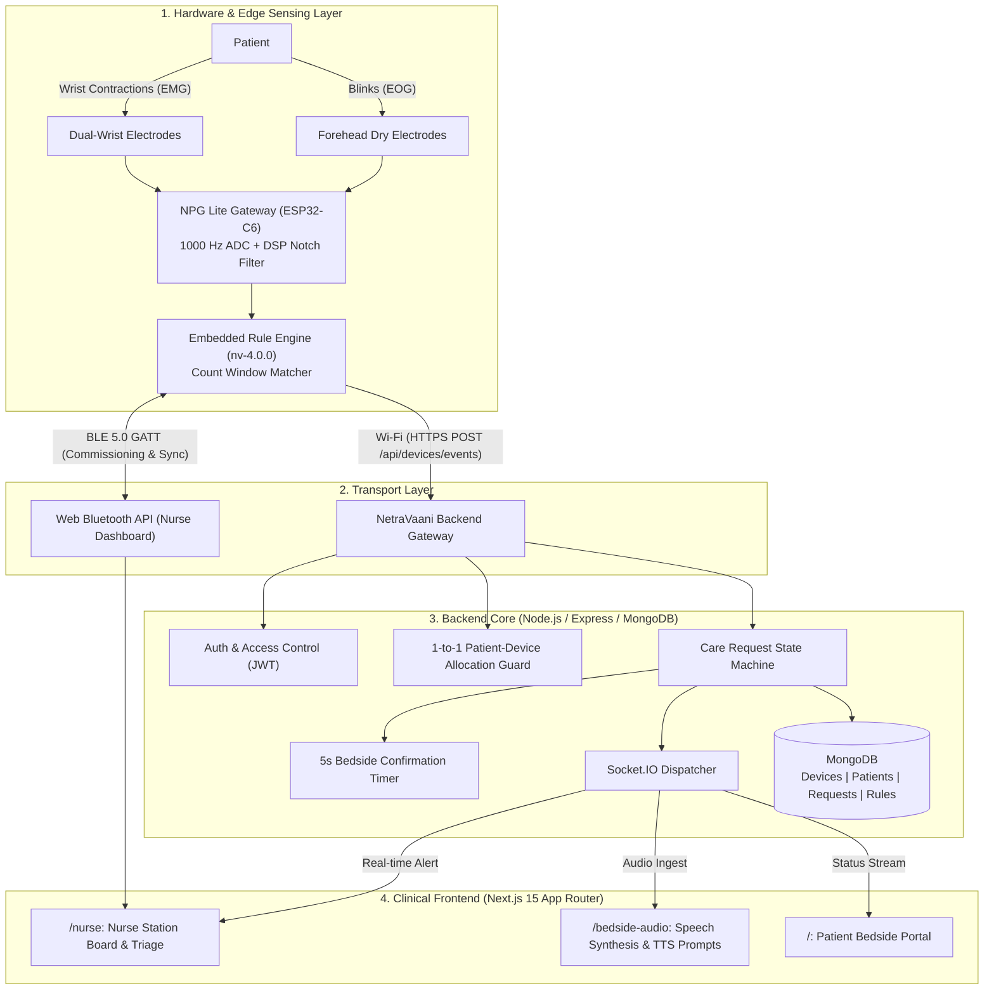
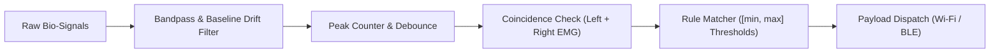
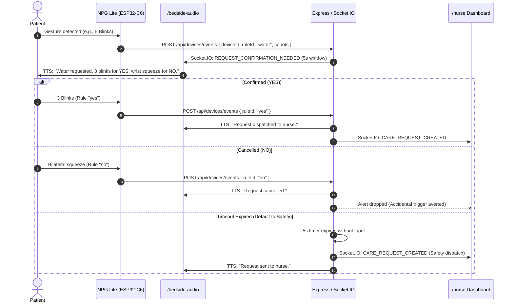
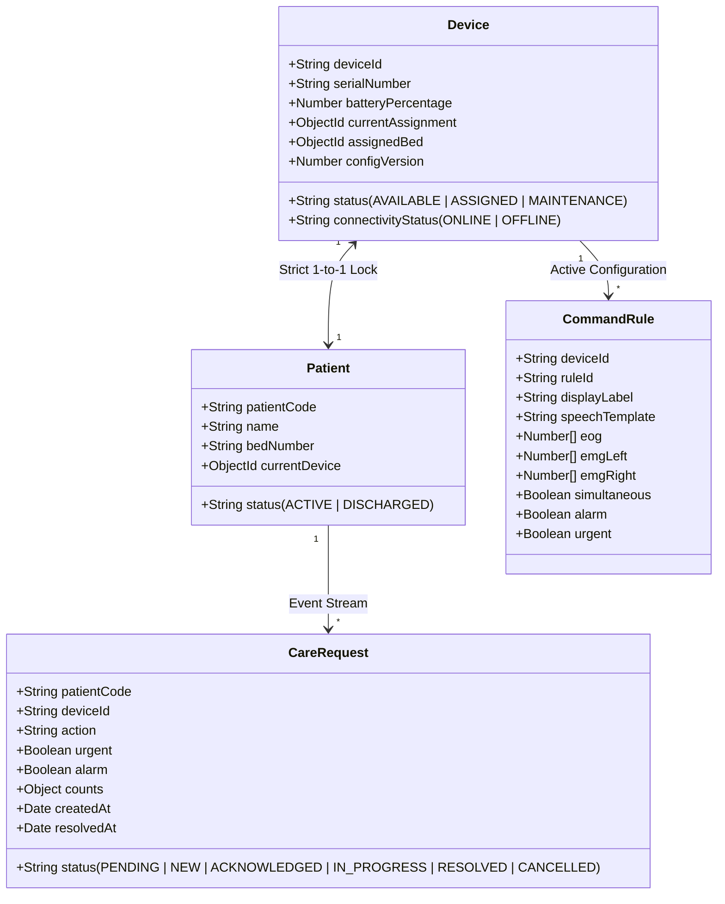

# NetraVaani System Architecture

Assistive biosignal translation and real-time clinical nurse-call system for non-verbal / motor-impaired patients.

---

## 1. High-Level Architecture

---

## 2. Hardware & Biosignal Ingestion

### 2.1 Signal Channels & Mapping

| Channel | Sensor Type | Physiological Source | Sample Rate | Typical Gesture Role |
|---|---|---|---|---|
| **EOG (Forehead)** | Ag/AgCl dry contacts | Corneo-retinal standing dipole | 1000 Hz | Blinks: 3–4 = `YES`, 5+ = `WATER` |
| **Left Wrist EMG** | Titanium / dry elastomer | Flexor carpi radialis | 1000 Hz | Left squeeze: 3+ = `CALL NURSE` |
| **Right Wrist EMG** | Titanium / dry elastomer | Flexor carpi radialis | 1000 Hz | Right squeeze: 3+ = `ADJUSTMENT` |
| **Bilateral EMG** | Time-coincident left + right | Synchronous contraction (&le; 350 ms) | Coincidence logic | Both wrists: 1–2 = `NO`, 3+ = `EMERGENCY` |

### 2.2 Edge Controller (NPG Lite)
- **MCU:** ESP32-C6 (160 MHz RISC-V).
- **Filtering:** 50/60 Hz hardware notch filter + digital bandpass (DC–30 Hz for EOG, 20–450 Hz for EMG).
- **Battery Life:** 3.7V 850mAh LiPo (~18 hours continuous operation).
- **Connectivity:** 2.4 GHz Wi-Fi 6 + BLE 5.0.

---

## 3. Firmware Rule Engine (`nv-4.0.0`)

Instead of running heavy inference on-device, the firmware evaluates configurable count ranges `[min, max]` over a sliding debounce window.

### Default Rule Set

| Rule ID | Action | EOG Counts | Left EMG | Right EMG | Simultaneous | Priority |
|---|---|---|---|---|---|---|
| `yes` | Confirmation | [3, 4] | [0, 0] | [0, 0] | No | Standard |
| `no` | Cancellation | [0, 20] | [1, 2] | [1, 2] | Yes | Standard |
| `water` | Care: Water | [5, 20] | [0, 0] | [0, 0] | No | Standard |
| `call_nurse`| Urgent Call | [0, 20] | [3, 20] | [0, 0] | No | Urgent |
| `adjustment`| Bed Adjustment | [0, 20] | [0, 0] | [3, 20] | No | Standard |
| `emergency` | Immediate Alarm | [0, 20] | [3, 20] | [3, 20] | Yes | Alarm (Critical) |

---

## 4. Care Request State Machine & Confirmation Flow

Accidental biosignal twitches are filtered using a **5-second confirmation window** executed via a bedside audio speaker before notifying the nurse station.

### Request Lifecycle States
1. `PENDING_DISPATCH_CONFIRMATION`: 5-second bedside verification window.
2. `NEW`: Pushed to nurse queue (`alarm` > `urgent` > `standard`).
3. `ACKNOWLEDGED`: Nurse claims the request.
4. `IN_PROGRESS`: Nurse attending to patient at bedside.
5. `RESOLUTION_CONFIRMATION`: Patient verifies service completed.
6. `RESOLVED`: Request closed and logged in history.

---

## 5. Backend Architecture & Data Models

- **Runtime:** Node.js, Express, TypeScript.
- **Database:** MongoDB via Mongoose.
- **Real-Time Layer:** Socket.IO with room-based broadcast.

### Key Safety Constraints
- **Strict 1-to-1 Device Allocation:** Prevents cross-bed signal contamination. A device cannot pair with Bed B while assigned to Bed A.
- **Request Throttling:** Caps active pending requests per patient (maximum 5) to prevent alert storms at the nurse desk.
- **Mandatory Safety Rules:** Custom rulesets must retain `YES`, `NO`, and `EMERGENCY` definitions.

---

## 6. Frontend Clinical Workspaces (Next.js 15)

1. **Nurse Central Station (`/nurse`):**
   - Live triage queue with visual priority hierarchy and audible alerts.
   - 3-step action workflow (`Acknowledge` &rarr; `Attend` &rarr; `Resolve`).
   - Device & Bed management table with battery and connectivity telemetry.
   - **Chords Signal Visualizer Modal:** Real-time raw bio-potential waveform viewer for checking electrode placement and impedance.
   - **Web Bluetooth (BLE) Commissioning:** Device setup directly from the browser without serial cables.

2. **Bedside Audio Terminal (`/bedside-audio`):**
   - Web Speech Synthesis (TTS) engine speaking configured messages (`speechTemplate`).
   - Screen Wake Lock API to prevent mobile/tablet sleep at the bedside.
   - Dynamic prompt adaptation reflecting active rule parameters.
   - Diagnostic signal simulator for testing count triggers without hardware.

3. **Patient Bedside Portal (`/`):**
   - Read-only interface showing assigned bed, assigned nurse, active call status, and gesture cheat-sheet.

---

## 7. Latency Budget

| Pipeline Stage | Latency |
|---|---|
| Signal acquisition & digital filtering | 25 ms |
| Firmware rule matching | < 5 ms |
| Wi-Fi transport (TLS REST POST) | 20–35 ms |
| Backend ingestion, auth & DB write | 15–20 ms |
| Socket.IO real-time broadcast | 10–15 ms |
| Bedside TTS audio trigger | ~40 ms |
| **Total System Reaction Time** | **~120–140 ms** |

Continue working on the existing NetraVaani project.

IMPORTANT: This is an incremental development task. Do NOT start analysing the entire codebase from scratch.

### Context loading
1. Reuse the existing conversation context.
2. Refer to AGENTS.md for permanent development rules.
3. Refer to PROJECT_CONTEXT.md for architecture and project knowledge.
4. Refer to CHANGELOG_AI.md for previously implemented features and decisions.
5. Do not rediscover information that is already documented and still valid.

### Before implementation
1. Understand my new requirement.
2. Identify the exact modules and files affected.
3. Inspect only those files and their direct dependencies.
4. Check existing implementations before changing anything.
5. If the task is straightforward, do not waste time generating a lengthy analysis report.

### Implementation rules
- Make minimal, targeted changes.
- Reuse existing services, APIs, models, components, and utilities.
- Do not duplicate existing functionality.
- Do not refactor unrelated code.
- Preserve all previously working features.
- Maintain backward compatibility wherever possible.
- Consider security, reliability, race conditions, and failure handling where relevant.
- Do not change unrelated database schemas or API contracts.
- Never remove existing functionality without explicit permission.

### Testing
- Run relevant targeted tests.
- Add tests for new functionality.
- Verify important edge cases.
- Do not run the entire test suite unnecessarily.
- Never claim a test passed without executing it.

### Context maintenance
After implementation:
- Update CHANGELOG_AI.md with verified changes.
- Update PROJECT_CONTEXT.md only if architecture or important technical information changes.
- Do not rewrite either file unnecessarily.

### Final response
Briefly report:
1. What you implemented.
2. Files modified.
3. Tests executed and results.
4. Remaining issues.

If you encounter missing context, inspect only what is necessary to resolve it.

If there is enough information to proceed, start implementing immediately.

---

### MY NEW REQUIREMENT:

[PASTE YOUR NEW COMMAND HERE]